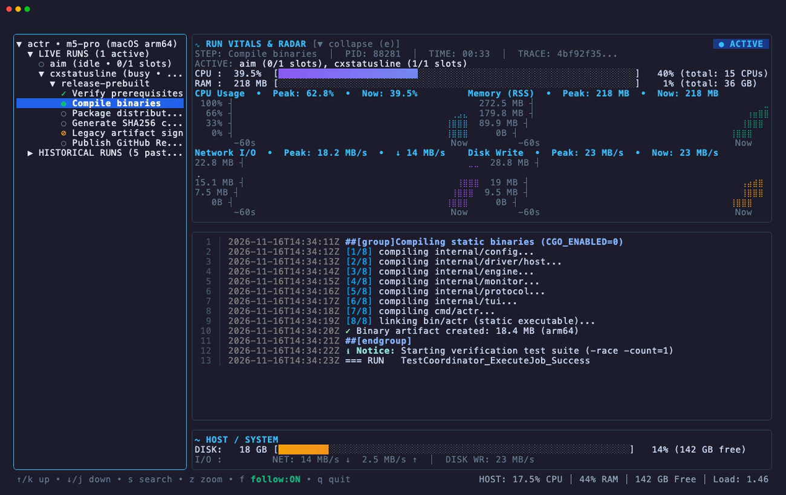
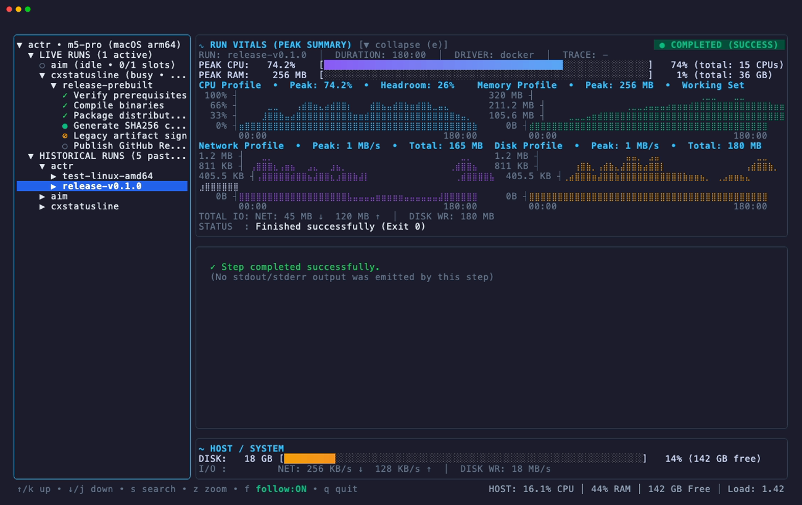

<div align="center">

# actr

**⚡ Lightweight, native GitHub Actions runner daemon and interactive monitoring TUI.**

*Single static binary. Sub-25 MB RAM. Zero-click registration. Real-time telemetry.*

[](https://github.com/adrijshikhar/actr/actions/workflows/ci.yml)
[](https://github.com/adrijshikhar/actr/releases/latest)
[](https://github.com/adrijshikhar/homebrew-tap)
[](https://golang.org)
[](https://golang.org)
[](LICENSE)

<br/>

<p align="center">
  
</p>

</div>

```bash
actr register              # zero-click registration (auto-detects repo & token via gh)
actr service install       # install background OS service (launchd on macOS, systemd on Linux)
actr service start         # start the runner daemon in the background
actr monitor               # launch interactive TUI dashboard (tree, telemetry, live logs)
actr doctor                # check prerequisites, git, node, and toolchain dependencies
```

---

## ✨ Features

- **Single static binary** — 100% pure Go (`CGO_ENABLED=0`), zero CGO, zero external binary runtime dependencies.
- **Bare-metal performance** — sub-25 MB idle RAM (vs 350+ MB for .NET CoreCLR); runs directly on native compilers without container overhead.
- **Zero-click registration** — automatically detects repository URL from `git remote origin` and acquires runner tokens via `gh` CLI.
- **Interactive TUI dashboard** — unified explorer tree (`Workflow` → `Job` → `Steps` + `Historical Runs`), live CPU/RAM/Net/Disk telemetry with expandable 4-graph Braille wave profiles (`e`), streaming ANSI logs, and single-key zoom (`z`).
- **Real-time host vitals HUD** — persistent status bar monitoring host CPU, RAM, disk headroom, and dynamic I/O rates (`net rx/tx`, `disk write`).
- **OpenTelemetry & metrics export** — stream live runner and host metrics directly to any OTLP collector (InfluxDB v3, Prometheus, Datadog, Grafana) via `--otel-endpoint`.
- **Local run & log persistence** — automatically preserves past job metadata, duration, peak vitals (CPU/RSS), and full ANSI-colored step logs under `~/.actr/runs/`.
- **Offline history browsing** — inspect historical runs anytime with `actr monitor` even when the daemon is stopped, with seamless background auto-reconnect when the runner starts.
- **Decoupled daemon architecture** — background daemon runs headlessly; terminal monitor attaches/detaches over a Unix socket (`~/.actr/daemon.sock`) without interrupting jobs.
- **Strict workspace hygiene** — credentials, runner state, and IPC socket live exclusively in `~/.actr/` (`0600` permissions), never polluting your repository.
- **Self-healing & unattended** — automated token refresh, session recovery, and process-group isolation (`-pgid`) on cancellation.

---

## 🚀 Quick Start

### Installation

#### Option 1: Standalone Installer (macOS & Linux, Recommended)
Run the one-line POSIX installer to automatically verify SHA256 checksums, install the binary to `/usr/local/bin` (or `~/.local/bin`), and configure shell completions for Zsh, Bash, and Fish:
```bash
curl -fsSL https://raw.githubusercontent.com/adrijshikhar/actr/main/install.sh | sh
```

#### Option 2: Homebrew Tap (macOS & Linux)
Install via the official verified Homebrew tap:
```bash
brew tap adrijshikhar/tap
brew install --cask actr
```

#### Option 3: Manual Binary Download
Download the latest pre-compiled archive for your OS and architecture from [GitHub Releases](https://github.com/adrijshikhar/actr/releases/latest):
- macOS Apple Silicon: `actr_<version>_darwin_arm64.tar.gz`
- macOS Intel: `actr_<version>_darwin_amd64.tar.gz`
- Linux ARM64: `actr_<version>_linux_arm64.tar.gz`
- Linux x86_64: `actr_<version>_linux_amd64.tar.gz`

Extract and move the binary to your `PATH`:
```bash
tar -xzf actr_*_darwin_arm64.tar.gz
sudo mv actr /usr/local/bin/
```

#### Option 4: From Source
Build directly with Go 1.27+:
```bash
git clone https://github.com/adrijshikhar/actr.git && cd actr
make install   # builds static binary and installs to ~/.local/bin/actr with zsh autocompletion
```

### 1. Register

Run `actr register` inside any Git repository:
```bash
actr register
```
It auto-detects your remote repository URL, acquires a registration token through `gh`, saves credentials to `~/.actr/`, and prompts to start the background service.

*For headless / CI environments:*
```bash
actr register --url https://github.com/owner/repo --token <TOKEN> --name my-runner
```

### 2. Manage Service

```bash
actr service install    # install OS background service (launchd / systemd)
actr service start      # start runner daemon
actr service status     # verify service is running
```

### 3. Monitor

Attach to the live daemon or browse historical runs offline:
```bash
actr monitor                  # connect to live daemon or browse history if offline
actr monitor --runs-dir <dir> # browse history from a custom runs directory
actr monitor --demo           # launch simulation showcasing live and historical runs
```

<p align="center">
  
</p>

| Key | Action |
|---|---|
| `↑` / `k`, `↓` / `j` | Navigate items in the Explorer Tree |
| `Enter` / `Space` | Expand or collapse tree node |
| `e` | Expand / collapse 4-graph telemetry HUD (CPU, RAM, Net I/O, Disk Write) |
| `s` | Filter & search Explorer Tree |
| `Ctrl+F` / `/` | Search within active step logs |
| `c` | Copy highlighted / active step logs to system clipboard |
| `z` | Toggle 100% full-screen log zoom |
| `f` | Toggle auto-follow (tail) active step logs |
| `Tab` | Switch focus between Tree and Log Viewport |
| `q` / `Ctrl+C` | Detach monitor (daemon keeps running) |

---

## 🗄️ Local Run & Log Persistence

Every workflow execution processed by `actr` is automatically persisted on disk under `~/.actr/runs/` without requiring any external databases or background infrastructure.

### Storage Layout

```
~/.actr/runs/
├── index.json                  # Catalog index of all runs (ID, status, duration, step counts)
└── <job-id>/
    ├── meta.json               # Full execution record (peak CPU, peak RSS, duration, driver, limits)
    └── steps/
        ├── <step-1>.log        # Raw step stdout/stderr preserving ANSI colors and escapes
        └── <step-2>.log
```

### Offline History Browsing

You can inspect past workflow runs and step logs even when the runner daemon is stopped:
```bash
actr monitor
```
When `daemon.sock` is unreachable, `actr monitor` automatically launches in **Offline Mode** (`◉ OFFLINE (HISTORY)`):
- Displays completed runs grouped by repository under `HISTORICAL RUNS` in the unified Explorer Tree.
- Inspect peak vitals (peak CPU %, peak RSS RAM, total network I/O, disk writes) and duration in the HUD.
- Press `e` to expand multi-phase historical Braille execution profiles (CPU, Memory, Network, Disk).
- Step logs are retrieved directly from disk, preserving ANSI styling.
- Seamless auto-reconnect: if the daemon starts in the background, the monitor connects automatically and transitions to live streaming.

<p align="center">
  
</p>

To browse runs from a custom runs directory:
```bash
actr monitor --runs-dir /path/to/custom/runs
```

### Retention & LRU Pruning

Configure automatic log and run pruning via `~/.actr/config.yaml`:

```yaml
retention:
  max_runs: 50         # Retain up to 50 runs (default: 50)
  max_disk_mb: 200     # Prune oldest runs when total logs exceed 200 MB (default: 200 MB)
```

When either limit is exceeded after a job finishes, `actr` safely deletes the oldest run directories and updates `index.json`.

### Crash Recovery

If the daemon is killed (`SIGKILL`, reboot, power loss) mid-run, any job left in `running` status is automatically recovered and marked as `interrupted` upon the next daemon start or monitor boot.

---

## 📡 OpenTelemetry & Metrics Export

Stream live runner execution and host vitals directly to any OpenTelemetry collector (InfluxDB v3, Prometheus, Datadog, Grafana Mimir, Jaeger):

```bash
# Push metrics via OTLP/HTTP to InfluxDB or local collector
actr run --otel-endpoint http://localhost:4318

# Push via gRPC with custom auth headers
actr run --otel-endpoint localhost:4317 --otel-protocol grpc --otel-headers "Authorization=Bearer <token>"
```

### Exported Gauges
| Metric | Description |
|---|---|
| `actr.step.cpu_percent` | Instantaneous CPU % consumed by the active step process group |
| `actr.step.memory_rss_bytes` | Resident Set Size (RSS) memory consumption |
| `actr.step.net_rx_rate_bytes_per_second` | Network receive throughput |
| `actr.step.net_tx_rate_bytes_per_second` | Network transmit throughput |
| `actr.step.disk_write_rate_bytes_per_second` | Step disk write I/O rate |
| `actr.host.cpu_percent` | Total host machine CPU utilization |
| `actr.host.memory_used_bytes` / `actr.host.memory_total_bytes` | Host RAM consumption & total capacity |
| `actr.host.disk_used_bytes` / `actr.host.disk_total_bytes` | Host storage utilization & capacity |

---

## 🛠️ Usage

| Command | Description |
|---|---|
| `actr register` | Interactive zero-click runner registration wizard |
| `actr run` | Run runner daemon in foreground (listens for and executes jobs) |
| `actr monitor` | Open interactive TUI dashboard (connects to live daemon or browses offline history) |
| `actr service install` | Install native OS background daemon (`launchd` on macOS, `systemd` on Linux) |
| `actr service start` | Start the background daemon service |
| `actr service status` | Check service status (`running`, `installed/stopped`, `not installed`) |
| `actr service stop` | Stop the background daemon service |
| `actr service uninstall` | Remove background daemon service definition |
| `actr completion <shell>` | Generate shell completions (`zsh`, `bash`, `fish`, `powershell`) |
| `actr doctor` | Validate OS, architecture, Git, and Node.js prerequisites |
| `actr version` | Print version and commit build info |

---

## 📖 Architecture & Principles

`actr` follows strict design axioms documented in [**PRINCIPLES.md**](PRINCIPLES.md):
- Single static binary, zero bloat (sub-25 MB idle RAM vs. 350 MB for .NET CoreCLR).
- Total workspace hygiene (zero temporary wrapper scripts inside repo).
- Decoupled observability (IPC via Unix socket).

---

## 📄 License

[MIT](LICENSE) © [Adrij Shikhar](https://github.com/adrijshikhar)
